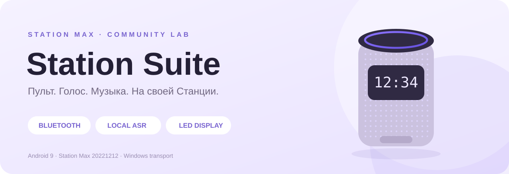
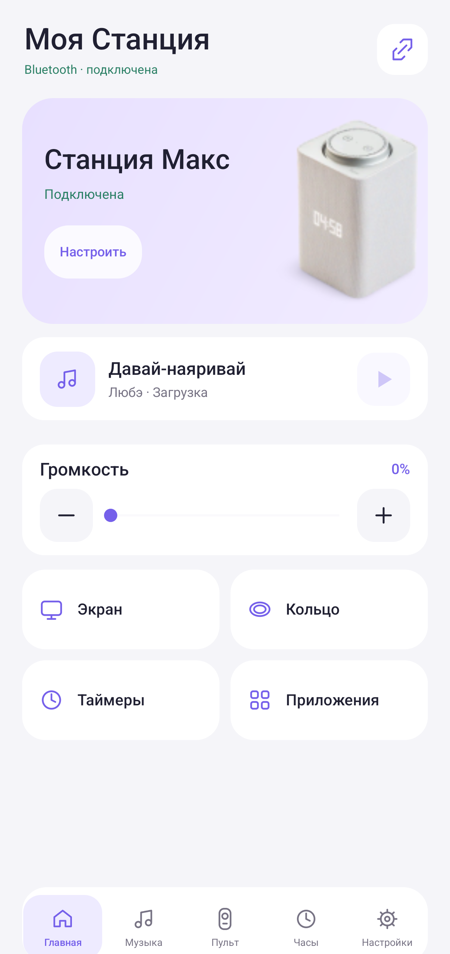
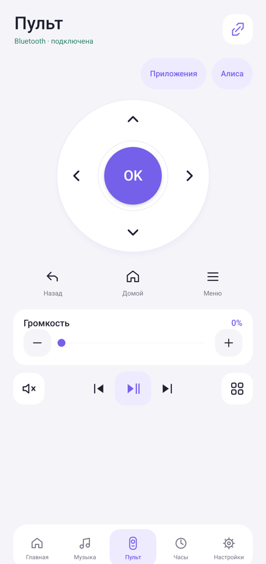
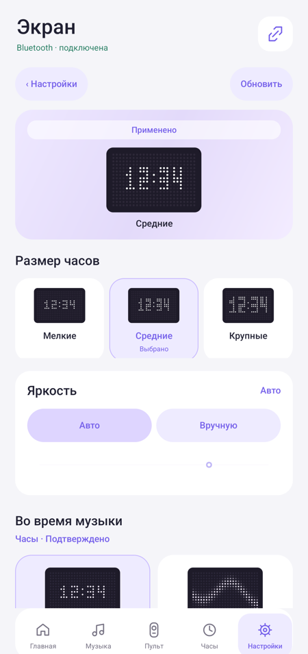
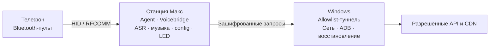

**Своя система управления Станцией Макс**

Bluetooth-пульт · локальное распознавание · музыка · часы и LED-дисплей

[Начать](docs/SETUP.md) · [Скачать приложения](https://github.com/B-a-t-0-n/station-suite/releases/latest) · [Архитектура](docs/ARCHITECTURE.md) · [Сборка](docs/BUILD.md)

Station Suite — комплект приложений и инструментов для модифицированной Яндекс Станции Макс. Телефон управляет колонкой напрямую по Bluetooth. Распознавание речи, команды, музыкальный каталог, таймеры и настройки выполняются на Станции. Основная схема использует ограниченный транспорт ПК; отдельно проверяется экспериментальный прямой Wi-Fi без транспорта ПК.

Проект проверен на **Android 9, прошивка 20221212**. Это конфигурация конкретного устройства, а не универсальная прошивка для всех колонок. После сообщения пользователя об обновлении выполнены factory reset, официальная проводная настройка и перезагрузка: ADB восстановлен, Android build и хеш штатного `maind` совпали с сохранёнными до сброса. Установка новой ОС/native-прошивки не подтверждена. Приложения Suite удалены сбросом; их восстановление ещё не начато.

## Приложение

Светлый интерфейс с фиолетовыми акцентами. Пять разделов: **Главная · Музыка · Пульт · Часы · Настройки**. Частые действия доступны сразу, параметры экрана имеют предпросмотр и подтверждение применения.

| Главная | Музыка | Пульт |
| :---: | :---: | :---: |
|  |  |  |
| Часы | Настройки | Экран колонки |
|  |  |  |

## Что умеет

| Возможность | Как работает |
| --- | --- |
| Пульт | Bluetooth HID: стрелки, OK, Домой, Назад, медиаклавиши |
| Музыка | Поиск и кеш на колонке; штатный плеер и музыкальные LED-анимации |
| Голос | Слово «Алиса» → локальное распознавание → команда или облачный ответ |
| Часы | Таймеры, будильники, голосовая установка и остановка, отсчёт на колонке |
| LED-дисплей | Размер часов, яркость, автояркость, варианты визуализации музыки |
| Веб-панель | Интерфейс Agent; адрес ПК передаёт трафик на Станцию |
| Сетевой контроль | В проводной схеме — конечный список интернет-источников; локальный config/OTA и проверка TLS |

**Верхнее кольцо и передний LED-дисплей — разные устройства.** Таймеры и системные события используют штатную индикацию кольца. Для будущей светомузыки уже проверен [цифровой спектр штатного плеера](docs/research/music-spectrum.md) на самой колонке. Произвольные RGB-эффекты кольца пока не реализованы. [Исследование кольца](docs/RING.md).

## Компоненты

Основная проводная схема:

| Компонент | Исходники | Назначение |
| --- | --- | --- |
| Пульт телефона | [apps/phone](apps/phone) | Управление и настройки по Bluetooth |
| Station Agent | [apps/agent](apps/agent) | Исполнение команд, музыка, таймеры и веб-интерфейс |
| Voicebridge | [apps/voicebridge](apps/voicebridge) | Голосовой тракт, локальные config/push/music-службы |
| Службы Windows | [pc](pc) | Транспорт, разрешённые маршруты и контроль состояния |
| CleanYourTV | [Форк лаунчера](https://github.com/B-a-t-0-n/cleanyourtv/tree/station/library-focus-layout) | ТВ-интерфейс, масштаб и галерея тем |

В выпуске **0.8.0**: телефон **0.8.0**, Agent **0.7.4**, Voicebridge **0.21**, лаунчер **3.4** и офлайн-пакет **29 тем**. Инструменты Windows публикуются ZIP-пакетом с исходниками и шаблонами. [Состав и проверки выпуска](docs/RELEASE-0.8.0.md) · [Точная версия и установка лаунчера](docs/LAUNCHER.md).

В основной проводной схеме ПК должен оставаться включённым. Сложные ответы и озвучивание используют внешние API GigaChat и Speechify. Доступность сервисов и их квоты определяются провайдерами.

В [экспериментальном режиме Wi-Fi](experimental/wifi-standalone/README.md) известные служебные запросы направляются в локальные config/push-службы, а облачные API и музыка используют прямой интернет. Голос, песня и локальный config были проверены без кабеля до перезагрузки. Затем наблюдалось сообщение об обновлении; последующая проверка не выявила изменения Android build и native `maind`. Возможные обновления APK до factory reset теперь не установить. **Безопасность этого режима от OTA не доказана.** Сейчас Wi-Fi выключен, используется изолированный Ethernet; работоспособность модификации после сброса ещё не восстановлена. [Хронология и результаты проверки](docs/research/wifi-autonomy.md).

## Восстановление с нуля

1. Подготовить совместимую Станцию с рабочим ADB и контролируемой сетью.
2. Скачать выпуск с APK и инструментами Windows, проверить контрольные суммы.
3. Установить компоненты, настроить сетевые интерфейсы и собственный приватный конфиг.
4. Восстановить приватные данные из своей резервной копии либо заполнить их заново.
5. Проверить локальный OTA/config, голос, музыку, Bluetooth и дисплей по [инструкции](docs/SETUP.md).

**Обычный factory reset не заменяет подготовку устройства.** Получение ADB, совместимость прошивки и доверие штатного TLS-клиента — отдельные предварительные условия. Секреты аккаунта, API-ключи, закрытые сертификаты и ключ подписи не входят в GitHub. [Границы воспроизводимости](docs/REPRODUCIBILITY.md).

## Разработка

Репозиторий содержит исходники, тесты, переносимые настройки сборки и шаблоны. Зависимости устанавливаются отдельно; личные пути и данные не должны требоваться для сборки. [Сборка и зависимости](docs/BUILD.md).

Для отчёта об ошибке указывайте версии приложений и прошивки, шаги воспроизведения и короткий код ошибки. Не прикладывайте приватные конфиги, API-ключи или полные сетевые журналы.

## Происхождение

Это независимый проект сообщества, не приложение Яндекса. Названия и изображения устройств принадлежат их правообладателям. Сторонние компоненты и материалы перечислены в [THIRD-PARTY.md](THIRD-PARTY.md). ТВ-приложения других разработчиков скачиваются у их авторов; их APK не перепубликуются в этом репозитории.
