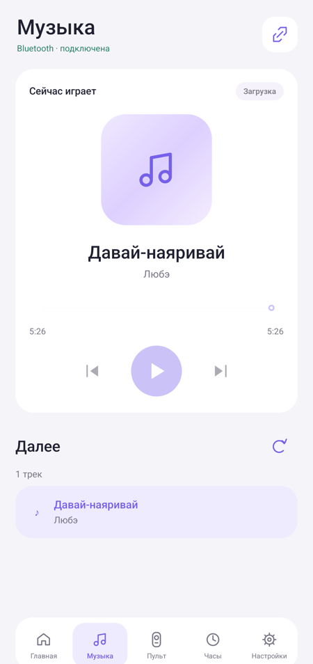
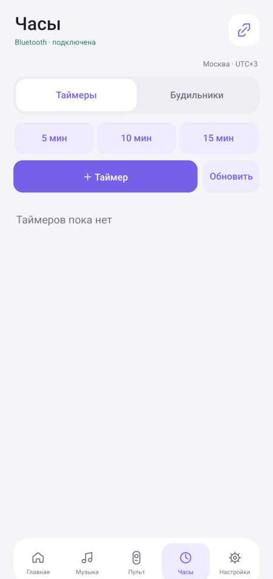
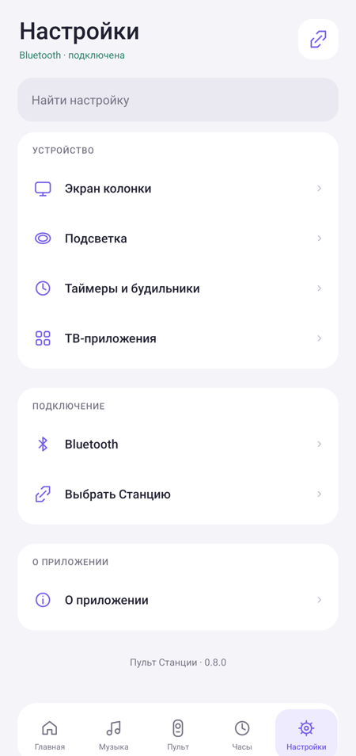
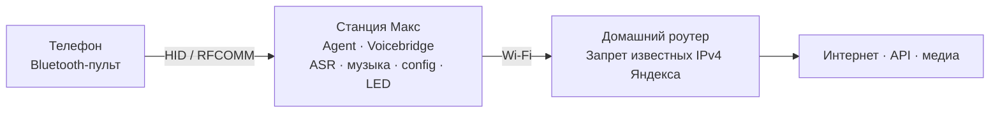

**Своя система управления Станцией Макс**

Bluetooth-пульт · локальное распознавание · музыка · часы и LED-дисплей

[Начать](docs/SETUP.md) · [Восстановить](docs/RECOVERY.md) · [Скачать приложения](https://github.com/B-a-t-0-n/station-suite/releases/latest) · [Архитектура](docs/ARCHITECTURE.md) · [Сборка](docs/BUILD.md)

Station Suite — комплект приложений и инструментов для модифицированной Яндекс Станции Макс. Телефон управляет колонкой напрямую по Bluetooth. Распознавание речи, команды, музыкальный каталог, таймеры и настройки выполняются на Станции. Проверены проводной режим с ограниченным транспортом ПК и домашний Wi-Fi без ПК с запретом известных адресов Яндекса. Wi-Fi-режим не гарантирует блокировку обновлений.

Проект проверен на **Android 9, прошивка 20221212**. Это конфигурация конкретного устройства, а не универсальная прошивка для всех колонок. После сообщения пользователя об обновлении выполнены factory reset, официальная проводная настройка и перезагрузка: ADB восстановлен, Android build и хеш штатного `maind` совпали с сохранёнными до сброса. Установка новой ОС/native-прошивки не подтверждена. Приложения, голос, локальные службы, оформление и Bluetooth-пульт возвращены в проводной схеме. Повторный холодный запуск ADB отдельно не подтверждён.

## Приложение

Светлый интерфейс с фиолетовыми акцентами. Пять разделов: **Главная · Музыка · Пульт · Часы · Настройки**. Частые действия доступны сразу, параметры экрана имеют предпросмотр и подтверждение применения.

| Главная | Музыка | Пульт |
| :---: | :---: | :---: |
|  |  |  |
| Часы | Настройки | Экран колонки |
|  |  |  |

## Что умеет

| Возможность | Как работает |
| --- | --- |
| Пульт | Bluetooth HID: стрелки, OK, Домой, Назад, медиаклавиши |
| Музыка | Поиск и кеш на колонке; штатный плеер и музыкальные LED-анимации |
| Голос | Слово «Алиса» → локальное распознавание → команда или облачный ответ |
| ТВ голосом | [Поиск фильма среди установленных видеосервисов или в выбранном приложении](docs/TV-VOICE.md) |
| Часы | Таймеры, будильники, голосовая установка и остановка, отсчёт на колонке |
| LED-дисплей | Размер часов, яркость, автояркость, варианты визуализации музыки |
| Веб-панель | Интерфейс самой Станции; в проводном режиме доступен также через ПК |
| Сетевой контроль | Провод: список разрешённых источников. Wi-Fi: обычный интернет и известные IPv4-запреты на роутере |

**Верхнее кольцо и передний LED-дисплей — разные устройства.** Таймеры и системные события используют штатную индикацию кольца. Для будущей светомузыки уже проверен [цифровой спектр штатного плеера](docs/research/music-spectrum.md) на самой колонке. Произвольные RGB-эффекты кольца пока не реализованы. [Исследование кольца](docs/RING.md).

## Компоненты

Проверенный домашний Wi-Fi без ПК:

| Компонент | Исходники | Назначение |
| --- | --- | --- |
| Пульт телефона | [apps/phone](apps/phone) | Управление и настройки по Bluetooth |
| Station Agent | [apps/agent](apps/agent) | Исполнение команд, музыка, таймеры и веб-интерфейс |
| Voicebridge | [apps/voicebridge](apps/voicebridge) | Голосовой тракт, локальные config/push/music-службы |
| Службы Windows | [pc](pc) | Транспорт, разрешённые маршруты и контроль состояния |
| CleanYourTV | [Форк лаунчера](https://github.com/B-a-t-0-n/cleanyourtv/tree/station/library-focus-layout) | ТВ-интерфейс, масштаб и галерея тем |

В выпуске **0.8.1**: телефон **0.8.0**, Agent **0.7.5**, Voicebridge **0.22**, лаунчер **3.4** и офлайн-пакет **29 тем**. Инструменты Windows публикуются ZIP-пакетом с исходниками и шаблонами. [Состав выпуска](docs/RELEASE-0.8.1.md) · [Точная версия и установка лаунчера](docs/LAUNCHER.md).

В основной проводной схеме ПК должен оставаться включённым. Сложные ответы и озвучивание используют внешние API GigaChat и Speechify. Доступность сервисов и их квоты определяются провайдерами.

18 ноября [режим Wi-Fi с известными IPv4-запретами](docs/research/ordinary-wifi-known-deny.md) проверен после перезагрузки без Ethernet-кабеля и транспорта ПК. Подтверждены обычный HTTPS, локальный config, автоматическое время и запуск служб; пользователь подтвердил новый голос и музыку. **Гарантии блокировки OTA нет:** неизвестные адреса и IPv6 могут обойти этот список. [История проверок](docs/research/wifi-autonomy.md).

## Быстрое восстановление

При доступном ADB и подготовленных приватных профилях один запуск `./tools/Restore-Station.ps1 -Apply` возвращает приложения, модель, настройки, темы и PC-транспорт. Без `-Apply` выполняется только проверка. Для уже работающего внешнего DHCP добавьте `-ExternalDhcp`, для повторного Bluetooth-сопряжения — `-PairBluetooth`. Личные профили и ключи остаются вне Git. [Пошаговое восстановление](docs/RECOVERY.md).

После factory reset сначала нужны официальная проводная настройка со звуковым кодом, своя приватная конфигурация и повторная проверка ADB после перезагрузки. Сброс не является обычным способом устранения сетевого сбоя. Репозиторий не прошивает и не разблокирует Станцию; аккаунты, TLS-ключи и signer остаются у владельца. [Установка PC-транспорта](docs/SETUP.md) · [Границы воспроизводимости](docs/REPRODUCIBILITY.md).

## Разработка

Репозиторий содержит исходники, тесты, переносимые настройки сборки и шаблоны. Зависимости устанавливаются отдельно; личные пути и данные не должны требоваться для сборки. [Сборка и зависимости](docs/BUILD.md).

Для отчёта об ошибке указывайте версии приложений и прошивки, шаги воспроизведения и короткий код ошибки. Не прикладывайте приватные конфиги, API-ключи или полные сетевые журналы.

## Происхождение

Это независимый проект сообщества, не приложение Яндекса. Названия и изображения устройств принадлежат их правообладателям. Сторонние компоненты и материалы перечислены в [THIRD-PARTY.md](THIRD-PARTY.md). ТВ-приложения других разработчиков скачиваются у их авторов; их APK не перепубликуются в этом репозитории.
